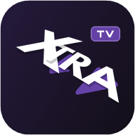

# Xtra TV

  

A Twitch client for Android TV with remote navigation, live chat, and hardware-aware video codec selection.

[Download Xtra TV](https://github.com/gggg-unit/Xtra/releases/latest) for Android 8.0 or newer.

- **ARMv7 (32-bit)** — `app-armeabi-v7a-release.apk`
- **ARMv8 (64-bit)** — `app-arm64-v8a-release.apk`

Based on [thiscallnet/Xtra](https://github.com/thiscallnet/Xtra) and [crackededed/Xtra](https://github.com/crackededed/Xtra). Licensed under the [GNU AGPL v3.0](LICENSE).
